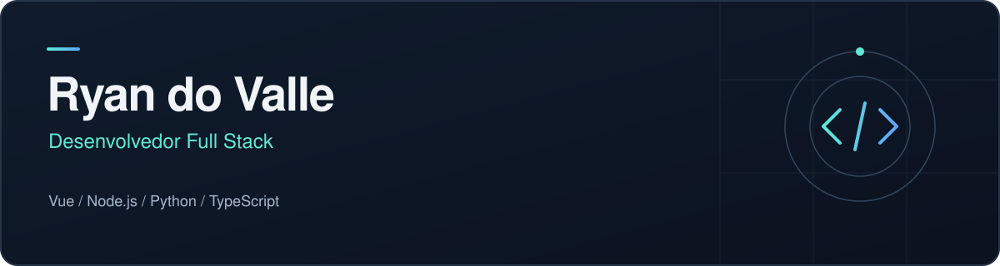

 

<a href="mailto:contact@ryandovalle.dev">E-mail</a>
&nbsp;&nbsp;·&nbsp;&nbsp;
<a href="https://github.com/Ryandovalle?tab=repositories">Repositórios</a>

 

## Sobre

Sou Ryan do Valle, desenvolvedor Full Stack. Trabalho com Vue, Node.js, Python e TypeScript no desenvolvimento de aplicações web, conectando interfaces, lógica de negócio e dados. Também trabalho com GitHub e GitLab para versionamento de código e colaboração em projetos.

## Em números

| Indicador | Quantidade |
| :--- | :--- |
| Repositórios privados pessoais no GitHub | **7** |
| Commits no GitHub nos últimos 12 meses | **131+** |

Consulta em 23/10/2026. Commits registrados no perfil entre 24/10/2025 e 23/10/2026, incluindo atividade em organizações. Contagens do GitHub; não incluem o GitLab.

## Tecnologias

| Área | Tecnologias |
| :--- | :--- |
| Front-end | Vue · JavaScript · TypeScript |
| Back-end | Node.js · Python · PHP |
| Dados e ferramentas | PostgreSQL · Docker · Git |
| Plataformas | GitHub · GitLab |

## Projetos e código

Nos meus [repositórios públicos](https://github.com/Ryandovalle?tab=repositories), você encontra meus projetos e o código que desenvolvo.

## Contato

Para conversar sobre projetos e oportunidades: **[contact@ryandovalle.dev](mailto:contact@ryandovalle.dev)**.
